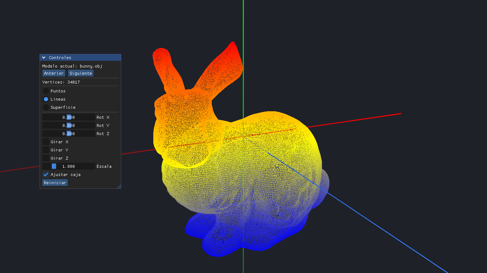
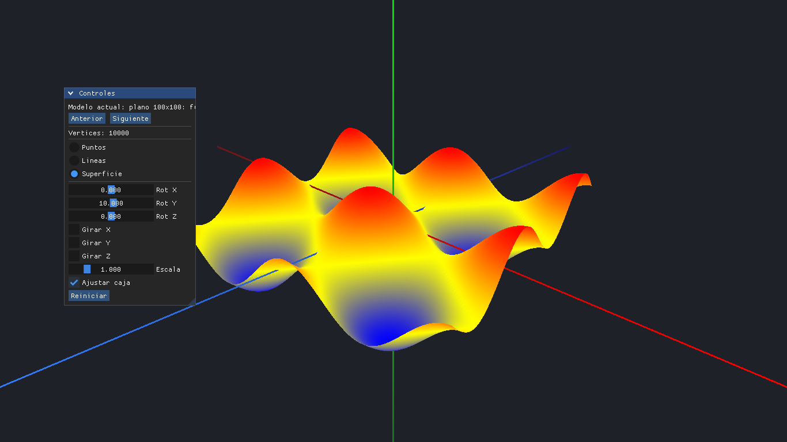
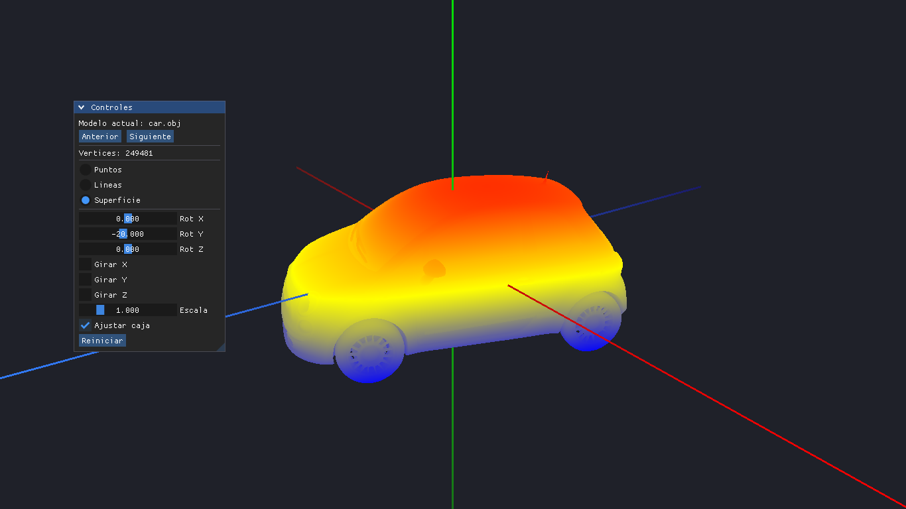
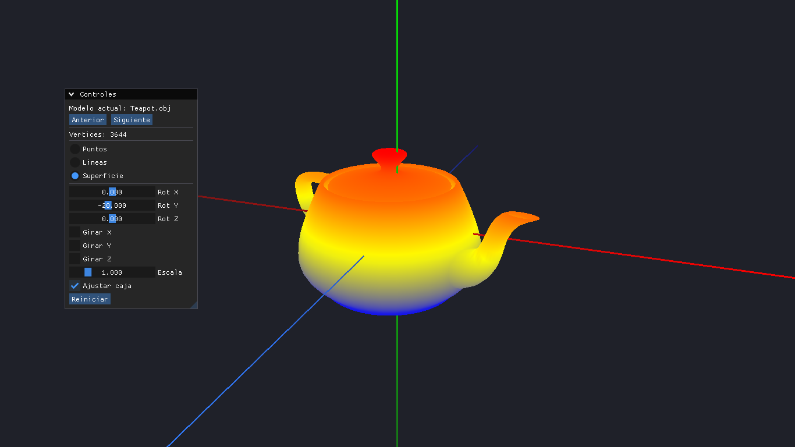
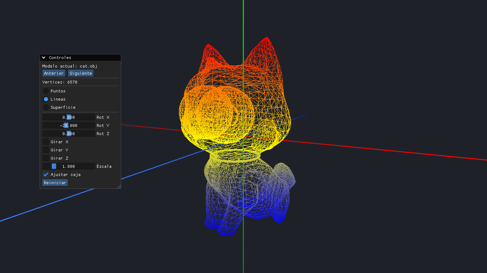

# Proyecto de medio semestre: Visualizador 3D

Visualizador desarrollado en C++ con OpenGL, GLFW, GLEW y GLM
Tambien esta la interfaz grafica con dear ImGui, se implemento la camara orbital con el ratón y el plano matemático de 100x100 vertices

## requisitos de dependencias

Para compilar el proyecto se necesitan las librerias de OpenGL, GLFW, GLEW, GLM y CMake

SIstema usado para el desarollo: ARCH LINUX
$ sudo pacman -S base-devel cmake git glfw glew glm

copiamos en la raiz del proyecto:

mkdir -p vendor
git clone --depth 1 [https://github.com/ocornut/imgui.git](https://github.com/ocornut/imgui.git) vendor/imgui

Para la interfaz grafica

Estructura:
- main.cpp  === codigo principal donde se leen los modelos y esta el plano matematico
- CMakeLists.txt ==== compilacion de cmake
- shaders/ ==== carpeta donde esta todo lo referente a los visuales para colorear los modelos segun la altura
- modelos/ ==== modelos que va a leer el programa

### Compilacion del proyecto
$ cd Proyecto
$ mkdir -p build
$ cd build
$ cmake ..
$ make
$ cd ..

en la carpeta raiz Proyecto 

$ ./build/visualizador

## Salida de la terminal

======================================================
 COntroles:
  [Flechas lados] : cambiar de modelo
  [1 - 3]             : 1=puntos, 2=lineas, 3=superficie
  [X  Y  Z]             : alternar rotacion en eje X, Y o Z
  [W/S A/D Q/E]         : rotar manualmente en X, Y, Z
  [raton + click Izq+Mover] : orbitar)
  [rueda raton]       : Zoom
  [r]                     : reiniciar
  [esc]                   : salir
======================================================
 Modelo: [1/2]: bunny.obj
 Vertices: 34817
 Minimo: (-1.8938, -0.340252, -1.23747)
 Maximo: (1.22018, 2.74642, 1.17599)
 Modelo: [2/2]: plano 100x100: f(x,z) = cos(x) + sin(z)
 Vertices: 10000
 Minimo: (-6.28319, -1.99937, -6.28319)
 Maximo: (6.28319, 1.99987, 6.28319)
 -> Minimo de f(x,z): -1.99937
 -> Maximo de f(x,z): 1.99987

## Capturas del programa

